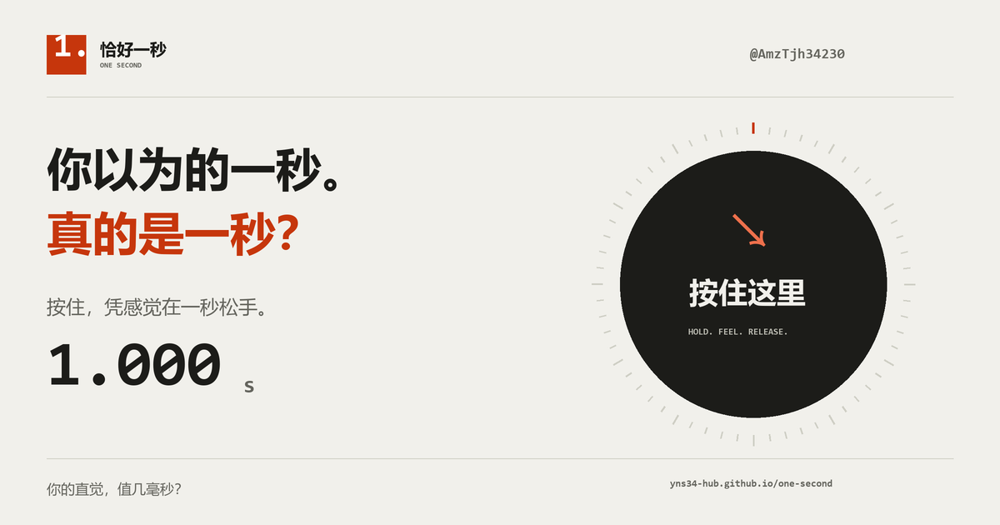

# 恰好一秒 · ONE SECOND

按住按钮，凭感觉在 **1.000 秒**松手。一个来自 [AMZ / @AmzTjh34230](https://x.com/AmzTjh34230) 的手感小游戏。



[打开挑战](https://yns34-hub.github.io/one-second/)

支持鼠标长按、手机触屏、空格和 Enter。结果会展示实际按压时长、毫秒偏差与趣味称号，可以导出 1200×1200 PNG 成绩卡，或生成让朋友挑战当前成绩的链接。

## 本地运行

安装 Node.js 20 或更高版本后，在项目目录运行：

```sh
npm start
```

打开 `http://127.0.0.1:4177`。不需要安装依赖，也没有构建步骤。测试使用 `npm test`。

## 文件

- `dist/`：完整静态网站，可部署在任何静态托管服务。
- `dist/app.js`：指针与键盘操作、结果展示、主题切换、成绩卡导出。
- `dist/core.js`：计分、挑战参数校验、分享文字、存储数据校验。
- `scripts/serve.mjs`：仅绑定本机回环地址的预览服务器。
- `scripts/make_assets.py`：社交封面生成源文件；需 Pillow 与 Windows 微软雅黑字体。
- `tests/core.test.mjs`：计分、参数边界、存储恢复和分享内容测试。

## 数据与分享

无账号、无后台、无追踪脚本。只在当前浏览器保留最近 30 次成绩、累计次数和最佳成绩。挑战链接只携带对方自愿分享的整数毫秒成绩。

使用 `performance.now()` 测量按压时长。切到后台、窗口失焦、系统取消指针或按住超过 10 秒时取消本局。成绩受浏览器和设备精度影响，趣味称号使用固定偏差阈值，不声称真人排名或统计百分位。

分享到 X 的按钮只打开已填文案的编辑器，由访客自行确认发布。成绩卡由浏览器 Canvas 本地生成。

## 发布更新

GitHub Pages 从 `gh-pages` 分支根目录发布。提交修改后执行：

```sh
git push origin main
git subtree push --prefix dist origin gh-pages
```

替换部署域名时，同步更新 `index.html` 中的分享元数据、`app.js` 中的成绩卡地址和封面生成脚本中的网址。
